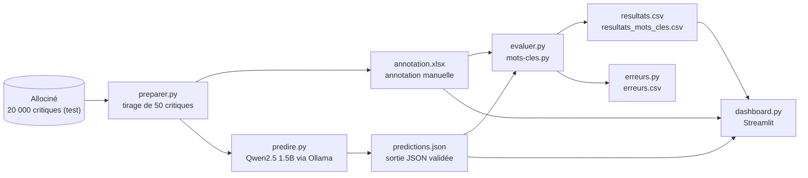

<div align="center">

# 🎬 Analyse des critiques de films par aspect

**Extraction d'aspects et de sentiments avec un LLM local, comparée à une méthode par mots-clés**


-000000)


*Mini-projet n°6 — IA — Fst Licence 3 — Année 2026-2027*

**Auteurs :** Rima ben arfi et Tasnim ben romdhane
**Encadrant :** Mme Imen ghrissi

</div>

---

## 📑 Sommaire

1. [Contexte et objectif](#-contexte-et-objectif)
2. [Aperçu du pipeline](#-aperçu-du-pipeline)
3. [Données](#-données)
4. [Méthodes](#-méthodes)
5. [Structure du dépôt](#-structure-du-dépôt)
6. [Installation](#-installation)
7. [Utilisation](#-utilisation)
8. [Résultats](#-résultats)
9. [Analyse des erreurs](#-analyse-des-erreurs)
10. [Tableau de bord](#-tableau-de-bord)
11. [Limites](#-limites)
12. [Perspectives](#-perspectives)
13. [Références](#-références)

---

## 🎯 Contexte et objectif

Une critique de film mélange souvent plusieurs opinions : *« scénario original, mais mise en scène molle »*. Une simple note globale ou un classement positif/négatif perd cette nuance.

Ce projet repère, pour chaque critique, **les aspects abordés** et **le sentiment associé à chacun** :

| Aspect | Exemples de ce qu'il couvre |
|---|---|
| `scenario` | histoire, intrigue, dialogues |
| `acteurs` | jeu, casting, interprétation |
| `realisation` | mise en scène, images, effets spéciaux |
| `musique` | bande originale, ambiance sonore |
| `duree` | longueur, rythme (« trop long », « trop court ») |

Sentiments possibles : `positif`, `negatif`, `neutre`.

**Question de recherche :** un petit LLM local (1,5 milliard de paramètres, tournant sur un PC sans carte graphique) fait-il mieux qu'une méthode simple par listes de mots-clés ? Et sur quels aspects ?

---

## 🧭 Aperçu du pipeline



---

## 📚 Données

| Élément | Détail |
|---|---|
| Source | Jeu **Allociné** (`tblard/allocine`) sur Hugging Face, critiques de films en français |
| Partition utilisée | `test` (20 000 critiques) |
| Échantillon | 50 critiques tirées au hasard (`seed = 42`), longueur entre 150 et 500 caractères |
| Annotation | Manuelle, rima a rempli 25 critique et tasnim 25 aussi, dans `annotation.xlsx` (liste déroulante `positif / negatif / neutre`) |

### Règles d'annotation

- Une cellule est **remplie** uniquement si la critique mentionne l'aspect.
- Une cellule est **vide** si l'aspect n'est pas mentionné.
- `neutre` signifie « l'aspect est mentionné **sans jugement clair** ou avec un avis mitigé ». Ce n'est **pas** un synonyme de « non mentionné ».

> ⚠️ Le jeu Allociné ne contient pas le titre du film : le tableau de bord est donc agrégé **par aspect** et non **par film**.

---

## 🔬 Méthodes

### 1. Extraction par LLM (Ollama)

- Modèle : `qwen2.5:1.5b`, exécuté localement avec **Ollama**.
- Le prompt demande de ne lister que les aspects réellement mentionnés, avec le sentiment et l'extrait de la critique.
- La sortie est **contrainte au format JSON** grâce au paramètre `format` d'Ollama, à partir d'un schéma **Pydantic** :

```python
class Aspect(BaseModel):
    aspect: Literal["scenario", "acteurs", "realisation", "musique", "duree"]
    sentiment: Literal["positif", "negatif", "neutre"]
    extrait: str
```

- Chaque réponse est ensuite **validée** : le taux de JSON valides est mesuré.

### 2. Méthode de référence par mots-clés

- Pour chaque aspect, une liste de mots (ex. *« musique », « bande originale »* pour `musique`).
- Les critiques sont découpées en phrases ; les phrases contenant un mot-clé sont retenues.
- Le sentiment est déterminé en comparant le nombre de mots positifs et négatifs dans ces phrases.

### 3. Métriques

Pour **chaque aspect**, on compare la détection du modèle à l'annotation manuelle :

| Métrique | Signification |
|---|---|
| **Précision** | parmi les aspects annoncés par la méthode, part des aspects réellement mentionnés |
| **Rappel** | parmi les aspects réellement mentionnés, part retrouvée par la méthode |
| **F1** | moyenne harmonique de la précision et du rappel |
| **Sentiment correct** | parmi les aspects trouvés **à la fois** par l'annotateur et la méthode, nombre de sentiments identiques |
| **JSON valides** | part des sorties du LLM respectant le schéma Pydantic |

---

## 🗂️ Structure du dépôt

```
project 6 ia/
├── preparer.py              # tire 50 critiques et crée annotation.xlsx
├── predire.py               # lance le LLM → predictions.json
├── evaluer.py               # métriques du LLM → resultats.csv
├── mots-cles.py             # méthode par mots-clés → resultats_mots_cles.csv
├── erreurs.py               # liste et classe les erreurs → erreurs.csv
├── dashboard.py             # tableau de bord Streamlit
├── extraction.py            # test d'extraction sur quelques critiques
├── test.py                  # test de la chaîne datasets + Ollama
├── annotation.xlsx          # annotation manuelle (vérité terrain)
├── predictions.json         # sorties du LLM
├── resultats.csv            # métriques du LLM
├── resultats_mots_cles.csv  # métriques des mots-clés
├── erreurs.csv              # erreurs classées par type
├── requirements.txt
└── README.md
```

---

## ⚙️ Installation

**Prérequis :** Python 3.10+ et [Ollama](https://ollama.com) installé.

```bash
# 1. Environnement virtuel
python -m venv venv
venv\Scripts\activate          # Windows
# source venv/bin/activate     # Linux / macOS

# 2. Dépendances
pip install datasets ollama pydantic scikit-learn pandas matplotlib streamlit openpyxl
# ou : pip install -r requirements.txt

# 3. Modèle local
ollama pull qwen2.5:1.5b
```

> 💡 Sur un PC avec 8 Go de RAM et sans GPU, comptez **15 à 50 secondes par critique**.

---

## ▶️ Utilisation

Exécuter les scripts **dans cet ordre** :

```bash
python preparer.py          # 1. crée annotation.xlsx (50 critiques à annoter)
#    → annoter à la main dans Excel, puis enregistrer et fermer le fichier

python predire.py           # 2. LLM sur les 50 critiques → predictions.json
python evaluer.py           # 3. métriques du LLM
python mots-cles.py         # 4. métriques de la méthode par mots-clés
python erreurs.py           # 5. analyse des erreurs → erreurs.csv
streamlit run dashboard.py  # 6. tableau de bord → http://localhost:8501
```

---

## 📊 Résultats

> ⚠️ **Valeurs provisoires.** À régénérer avec `evaluer.py` et `mots-cles.py` après la correction finale de `annotation.xlsx`, puis à recopier ici depuis `resultats.csv` et `resultats_mots_cles.csv`.

**Qualité du format :** JSON valides = **50 / 50**.

### F1 par aspect

| Aspect | LLM (Qwen2.5 1.5B) | Mots-clés |
|---|:---:|:---:|
| scenario | 1.00 | 0.55 |
| acteurs | 0.73 | 0.73 |
| realisation | 0.81 | 0.48 |
| musique | 0.21 | 0.29 |
| duree | 0.10 | 0.25 |

### Détail : précision / rappel

| Aspect | LLM — Précision | LLM — Rappel | Mots-clés — Précision | Mots-clés — Rappel |
|---|:---:|:---:|:---:|:---:|
| scenario | 1.00 | 1.00 | 1.00 | 0.38 |
| acteurs | 0.60 | 0.93 | 0.95 | 0.60 |
| realisation | 0.74 | 0.89 | 1.00 | 0.32 |
| musique | 0.12 | 0.67 | 1.00 | 0.17 |
| duree | 0.06 | 0.29 | 1.00 | 0.14 |

### Sentiment correct (parmi les aspects trouvés par les deux)

| Aspect | LLM | Mots-clés |
|---|:---:|:---:|
| scenario | 40 / 50 | 7 / 19 |
| acteurs | 21 / 28 | 7 / 18 |
| realisation | 18 / 34 | 4 / 12 |
| musique | 2 / 4 | 1 / 1 |
| duree | 2 / 2 | 0 / 1 |

### Lecture des résultats

- Le **LLM** retrouve la plupart des aspects réellement mentionnés (rappel élevé) mais **ajoute des aspects absents** de la critique (précision plus faible), surtout pour `musique` et `duree`.
- La méthode par **mots-clés** est **précise** (quand elle détecte un aspect, c'est presque toujours juste) mais **rate beaucoup d'aspects** : sa liste de mots est limitée et elle ne comprend pas les formulations indirectes.
- Sur le **sentiment**, le LLM est nettement meilleur que le comptage de mots positifs et négatifs.
- Les aspects `musique` (6 critiques) et `duree` (7 critiques) reposent sur **très peu d'exemples** : leurs scores sont peu fiables.

---

## 🔍 Analyse des erreurs

`erreurs.py` classe chaque désaccord entre l'annotation et la méthode en trois types :

| Type d'erreur | Définition |
|---|---|
| **Aspect inventé** | la méthode annonce un aspect que la critique ne mentionne pas |
| **Aspect raté** | la critique mentionne un aspect que la méthode ne trouve pas |
| **Mauvais sentiment** | l'aspect est trouvé, mais avec un sentiment différent de l'annotation |

Exemples commentés *(à compléter depuis `erreurs.csv`)* :

| # | Critique (extrait) | Annotation | Modèle | Type | Explication |
|---|---|---|---|---|---|
| 1 | *[extrait]* | *[ ]* | *[ ]* | *[ ]* | *[pourquoi le modèle se trompe]* |
| 2 | *[extrait]* | *[ ]* | *[ ]* | *[ ]* | *[ ]* |
| 3 | *[extrait]* | *[ ]* | *[ ]* | *[ ]* | *[ ]* |

---

## 🖥️ Tableau de bord

Lancé avec `streamlit run dashboard.py`, il propose trois onglets :

| Onglet | Contenu |
|---|---|
| **Comparaison** | tableaux de métriques du LLM et des mots-clés, graphique des F1 par aspect |
| **Critique par critique** | texte d'une critique, annotation manuelle et sortie du modèle côte à côte |
| **Aspects du modèle** | répartition des sentiments détectés pour chaque aspect |

*(Ajouter ici une capture d'écran : `docs/dashboard.png`.)*

---

## ⚠️ Limites

- **Petit modèle** (1,5 milliard de paramètres) : il invente des aspects et comprend mal l'ironie ou la double négation.
- **Échantillon réduit** : 50 critiques annotées ; `musique` et `duree` n'ont que quelques exemples.
- **Annotation par deux personnes** : pas de mesure d'accord entre annotateurs.
- **Pas de titre de film** dans le jeu de données : analyse par aspect, pas par film.
- **Méthode par mots-clés** volontairement simple : la comparaison avec le LLM dépend de la qualité de ces listes.

---

## 🚀 Perspectives

- [x] Sortie JSON contrainte et validée (Pydantic)
- [x] Méthode de référence par mots-clés
- [x] Métriques par aspect (précision, rappel, F1)
- [x] Tableau de bord Streamlit
- [ ] Étendre l'analyse du LLM aux **300 critiques**
- [ ] Mesurer l'**accord entre annotateurs** (kappa de Cohen)
- [ ] Tester un modèle plus grand (3B ou 7B) et comparer
- [ ] Ajouter des exemples dans le prompt (*few-shot*)
- [ ] Enrichir les listes de mots-clés

---

## 📎 Références

- Jeu de données : [`tblard/allocine`](https://huggingface.co/datasets/tblard/allocine) (Hugging Face)
- [Ollama](https://ollama.com) — exécution locale de LLM
- [Qwen2.5](https://ollama.com/library/qwen2.5) — famille de modèles
- [Pydantic](https://docs.pydantic.dev) — validation de schémas
- [scikit-learn](https://scikit-learn.org) — métriques de classification
- [Streamlit](https://streamlit.io) — tableau de bord interactif

---

<div align="center">
<sub>Projet réalisé dans le cadre d'un mini-projet d'IA — [fst], 2026</sub>
</div>