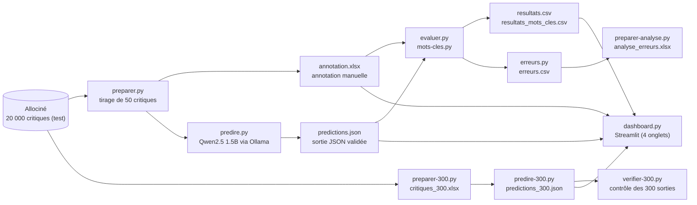

<div align="center"
# 🎬 Analyse de critiques de films par aspect

**Extraction d'aspects et de sentiments avec un LLM local, comparée à une méthode par mots-clés**


-000000)


*Mini-projet n°6 — IA — Licence 3 Mathématiques et Informatique — Année 2026-2027*

**Auteures :** Rima Ben Arfi et Tasnim Ben Romdhane
**Encadrante :** Mme Imen El Ghrissi
**Établissement :** Faculté des Sciences (Tunisie)

</div>

---

## 📑 Sommaire

1. [Contexte et objectif](#-contexte-et-objectif)
2. [Aperçu du pipeline](#-aperçu-du-pipeline)
3. [Données](#-données)
4. [Méthodes](#-méthodes)
5. [Structure du dépôt](#-structure-du-dépôt)
6. [Installation](#-installation)
7. [Utilisation](#-utilisation)
8. [Résultats sur les 50 critiques annotées](#-résultats-sur-les-50-critiques-annotées)
9. [Passage à l'échelle : 300 critiques](#-passage-à-léchelle--300-critiques)
10. [Analyse des erreurs](#-analyse-des-erreurs)
11. [Tableau de bord](#-tableau-de-bord)
12. [Limites](#-limites)
13. [Perspectives](#-perspectives)
14. [Annexe : prompt utilisé](#-annexe--prompt-utilisé)
15. [Références](#-références)

---

## 🎯 Contexte et objectif

Une critique de film mélange souvent plusieurs opinions : *« scénario original, mais mise en scène molle »*. Une simple note globale ou un classement positif/négatif perd cette nuance.

Ce projet repère, pour chaque critique, **les aspects abordés** et **le sentiment associé à chacun** :

| Aspect | Exemples de ce qu'il couvre |
|---|---|
| `scenario` | histoire, intrigue, dialogues |
| `acteurs` | jeu, casting, interprétation |
| `realisation` | mise en scène, images, effets spéciaux |
| `musique` | bande originale, ambiance sonore |
| `duree` | longueur, rythme (« trop long », « trop court ») |

Sentiments possibles : `positif`, `negatif`, `neutre`.

**Question de recherche :** un petit LLM local (1,5 milliard de paramètres, tournant sur un PC sans carte graphique) fait-il mieux qu'une méthode simple par listes de mots-clés ? Et sur quels aspects ?

**Réponse courte :** le LLM est nettement meilleur pour le **sentiment** et pour le **rappel**, mais il **invente des aspects** absents de la critique (précision faible sur `musique` et `duree`). La méthode par mots-clés fait l'inverse : très précise, mais elle rate la majorité des aspects.

---

## 🧭 Aperçu du pipeline



---

## 📚 Données

| Élément | Détail |
|---|---|
| Source | Jeu **Allociné** (`tblard/allocine`) sur Hugging Face, critiques de films en français |
| Partition utilisée | `test` (20 000 critiques) |
| Échantillon annoté | 50 critiques tirées au hasard (`seed = 42`), longueur entre 150 et 500 caractères |
| Annotation | Manuelle, dans `annotation.xlsx` : Rima a rempli 25 critiques et Tasnim 25 (liste déroulante `positif / negatif / neutre`) |
| Échantillon étendu | 300 critiques = les 50 annotées + 250 autres (même filtre de longueur, `seed = 42`), dans `critiques_300.xlsx` |

### Règles d'annotation

- Une cellule est **remplie** uniquement si la critique mentionne l'aspect.
- Une cellule est **vide** si l'aspect n'est pas mentionné.
- `neutre` signifie « l'aspect est mentionné **sans jugement clair** ou avec un avis mitigé ». Ce n'est **pas** un synonyme de « non mentionné ».

### Fréquence des aspects dans l'annotation manuelle (50 critiques)

| Aspect | Critiques où l'aspect est mentionné | Part |
|---|:---:|:---:|
| scenario | 50 / 50 | 100 % |
| realisation | 38 / 50 | 76 % |
| acteurs | 30 / 50 | 60 % |
| duree | 7 / 50 | 14 % |
| musique | 6 / 50 | 12 % |

> ⚠️ Le jeu Allociné ne contient pas le titre du film : le tableau de bord est donc agrégé **par aspect** et non **par film**.

---

## 🔬 Méthodes

### 1. Extraction par LLM (Ollama)

- Modèle : `qwen2.5:1.5b`, exécuté localement avec **Ollama**.
- Le prompt demande de ne lister que les aspects réellement mentionnés, avec le sentiment et l'extrait de la critique (voir l'[annexe](#-annexe--prompt-utilisé)).
- La sortie est **contrainte au format JSON** grâce au paramètre `format` d'Ollama, à partir d'un schéma **Pydantic** :

```python
class Aspect(BaseModel):
    aspect: Literal["scenario", "acteurs", "realisation", "musique", "duree"]
    sentiment: Literal["positif", "negatif", "neutre"]
    extrait: str

class Resultat(BaseModel):
    aspects: List[Aspect]
```

- Chaque réponse est ensuite **validée** avec `Resultat.model_validate_json(...)` : le taux de JSON valides est mesuré.
- Le script `predire-300.py` **sauvegarde après chaque critique** et **reprend automatiquement** là où il s'est arrêté (utile : 300 critiques demandent environ 2 heures sur notre machine).

### 2. Méthode de référence par mots-clés

- Pour chaque aspect, une liste de mots (ex. *« musique », « bande originale »* pour `musique`).
- Les critiques sont découpées en phrases ; les phrases contenant un mot-clé sont retenues.
- Le sentiment est déterminé en comparant le nombre de mots positifs et négatifs dans ces phrases.

### 3. Métriques

Pour **chaque aspect**, on compare la détection de la méthode à l'annotation manuelle :

| Métrique | Signification |
|---|---|
| **Précision** | parmi les aspects annoncés par la méthode, part des aspects réellement mentionnés |
| **Rappel** | parmi les aspects réellement mentionnés, part retrouvée par la méthode |
| **F1** | moyenne harmonique de la précision et du rappel |
| **Sentiment correct** | parmi les aspects trouvés **à la fois** par l'annotatrice et la méthode, nombre de sentiments identiques |
| **JSON valides** | part des sorties du LLM respectant le schéma Pydantic |

---

## 🗂️ Structure du dépôt

```
project 6 ia/
├── preparer.py              # tire 50 critiques et crée annotation.xlsx
├── predire.py               # lance le LLM sur les 50 → predictions.json
├── evaluer.py               # métriques du LLM → resultats.csv
├── mots-cles.py             # méthode par mots-clés → resultats_mots_cles.csv
├── erreurs.py               # liste et classe les erreurs → erreurs.csv
├── preparer-analyse.py      # échantillon de 10 erreurs → analyse_erreurs.xlsx
├── preparer-300.py          # tire 300 critiques → critiques_300.xlsx
├── predire-300.py           # LLM sur 300 critiques (reprise auto) → predictions_300.json
├── verifier-300.py          # contrôle des 300 sorties (JSON valides, distribution)
├── dashboard.py             # tableau de bord Streamlit (4 onglets)
├── extraction.py            # test d'extraction sur quelques critiques
├── test.py                  # test de la chaîne datasets + Ollama
├── annotation.xlsx          # annotation manuelle (vérité terrain, 50 critiques)
├── predictions.json         # sorties du LLM sur 50 critiques
├── predictions_300.json     # sorties du LLM sur 300 critiques
├── critiques_300.xlsx       # les 300 critiques analysées
├── resultats.csv            # métriques du LLM
├── resultats_mots_cles.csv  # métriques des mots-clés
├── erreurs.csv              # erreurs classées par type
├── analyse_erreurs.xlsx     # analyse manuelle de 10 erreurs
├── requirements.txt
└── README.md
```

---

## ⚙️ Installation

**Prérequis :** Python 3.10+ et [Ollama](https://ollama.com) installé.

```bash
# 1. Environnement virtuel
python -m venv venv
venv\Scripts\activate          # Windows
# source venv/bin/activate     # Linux / macOS

# 2. Dépendances
pip install datasets ollama pydantic scikit-learn pandas matplotlib streamlit openpyxl
# ou : pip install -r requirements.txt

# 3. Modèle local
ollama pull qwen2.5:1.5b
```

> 💡 Sur un PC avec 8 Go de RAM et sans GPU, comptez **15 à 50 secondes par critique** (environ 25 s en moyenne).

---

## ▶️ Utilisation

Exécuter les scripts **dans cet ordre** :

```bash
python preparer.py           # 1. crée annotation.xlsx (50 critiques à annoter)
#    → annoter à la main dans Excel, puis enregistrer et fermer le fichier

python predire.py            # 2. LLM sur les 50 critiques → predictions.json
python evaluer.py            # 3. métriques du LLM → resultats.csv
python mots-cles.py          # 4. métriques de la méthode par mots-clés
python erreurs.py            # 5. analyse des erreurs → erreurs.csv
python preparer-analyse.py   # 6. 10 erreurs à commenter à la main → analyse_erreurs.xlsx

python preparer-300.py       # 7. crée critiques_300.xlsx (vérifie aussi les id des 50 annotées)
python predire-300.py        # 8. LLM sur 300 critiques → predictions_300.json
#    → si le programme s'arrête, relancer la même commande : il reprend là où il s'est arrêté
python verifier-300.py       # 9. contrôle des 300 sorties

streamlit run dashboard.py   # 10. tableau de bord → http://localhost:8501
```

> Remarque : `predire-300.py` réutilise les résultats déjà présents dans `predictions.json` pour les 50 critiques annotées, puis traite les 250 autres.

---

## 📊 Résultats sur les 50 critiques annotées

**Qualité du format :** JSON valides = **50 / 50** (et **300 / 300** sur l'échantillon étendu).

### F1 par aspect

| Aspect | LLM (Qwen2.5 1.5B) | Mots-clés |
|---|:---:|:---:|
| scenario | 1.00 | 0.55 |
| acteurs | 0.73 | 0.73 |
| realisation | 0.81 | 0.48 |
| musique | 0.21 | 0.29 |
| duree | 0.10 | 0.25 |

### Détail : précision / rappel

| Aspect | Critiques (annotation) | LLM — Précision | LLM — Rappel | Mots-clés — Précision | Mots-clés — Rappel |
|---|:---:|:---:|:---:|:---:|:---:|
| scenario | 50 | 1.00 | 1.00 | 1.00 | 0.38 |
| acteurs | 30 | 0.60 | 0.93 | 0.95 | 0.60 |
| realisation | 38 | 0.74 | 0.89 | 1.00 | 0.32 |
| musique | 6 | 0.12 | 0.67 | 1.00 | 0.17 |
| duree | 7 | 0.06 | 0.29 | 1.00 | 0.14 |

### Sentiment correct (parmi les aspects trouvés par les deux)

| Aspect | LLM | Mots-clés |
|---|:---:|:---:|
| scenario | 40 / 50 | 7 / 19 |
| acteurs | 21 / 28 | 7 / 18 |
| realisation | 18 / 34 | 4 / 12 |
| musique | 2 / 4 | 1 / 1 |
| duree | 2 / 2 | 0 / 1 |

### Lecture des résultats

- Le **LLM** retrouve la plupart des aspects réellement mentionnés (rappel élevé) mais **ajoute des aspects absents** de la critique (précision plus faible), surtout pour `musique` (0,12) et `duree` (0,06).
- La méthode par **mots-clés** est **précise** (quand elle détecte un aspect, c'est presque toujours juste) mais **rate beaucoup d'aspects** : sa liste de mots est limitée et elle ne comprend pas les formulations indirectes.
- Sur le **sentiment**, le LLM est nettement meilleur que le comptage de mots positifs et négatifs (par exemple 40/50 contre 7/19 sur `scenario`).
- Le **scénario** est mentionné dans 50/50 critiques et le LLM le renvoie à chaque fois : son F1 de 1,00 est donc **trivial** et ne prouve pas que le modèle « comprend » mieux. La comparaison pertinente sur cet aspect porte sur le **sentiment correct**.
- Les aspects `musique` (6 critiques) et `duree` (7 critiques) reposent sur **très peu d'exemples** : leurs scores sont peu fiables.

---

## 📈 Passage à l'échelle : 300 critiques

Le LLM a été exécuté sur **300 critiques** (les 50 annotées + 250 autres) avec la même version du prompt. Les 250 critiques supplémentaires **n'ont pas d'annotation** : on n'y calcule donc ni précision ni rappel, seulement la **distribution** des aspects et des sentiments.

- JSON valides : **300 / 300**
- Nombre moyen d'aspects renvoyés par critique : **4,55** (sur 5 possibles)

### Aspects et sentiments renvoyés par le modèle (300 critiques)

| Aspect | négatif | neutre | positif | Total | Part des 300 critiques | Annotation manuelle (sur 50) |
|---|:---:|:---:|:---:|:---:|:---:|:---:|
| scenario | 102 | 63 | 132 | 297 | 99 % | 100 % |
| realisation | 67 | 120 | 111 | 298 | 99 % | 76 % |
| acteurs | 57 | 115 | 104 | 276 | 92 % | 60 % |
| duree | 44 | 169 | 54 | 267 | 89 % | 14 % |
| musique | 41 | 153 | 32 | 226 | 75 % | 12 % |

> Les totaux comptent des occurrences d'aspects renvoyées par le modèle. La colonne « Part » est ce total divisé par 300.

### Interprétation

- Le modèle renvoie **presque tous les aspects pour presque toutes les critiques** : `musique` est annoncée dans environ 75 % des critiques et `duree` dans environ 89 %, contre 12 % et 14 % dans l'annotation manuelle.
- Le sentiment `neutre` domine pour les aspects peu présents (`duree` : 169 sur 267 ; `musique` : 153 sur 226) : le modèle semble l'utiliser comme **valeur par défaut** quand l'aspect n'est pas mentionné.
- **Conséquence :** la distribution sur 300 critiques est **gonflée** et ne représente pas la réalité. Seules les 50 critiques annotées servent de référence pour les métriques.

---

## 🔍 Analyse des erreurs

`erreurs.py` classe chaque désaccord entre l'annotation et le modèle (sur les 50 critiques × 5 aspects) en trois types :

| Type d'erreur | Définition |
|---|---|
| **Aspect inventé** | le modèle annonce un aspect que la critique ne mentionne pas |
| **Aspect raté** | la critique mentionne un aspect que le modèle ne trouve pas |
| **Mauvais sentiment** | l'aspect est trouvé, mais avec un sentiment différent de l'annotation |

### Bilan : 141 erreurs

| Type d'erreur | Nombre |
|---|:---:|
| Aspect inventé | **93** |
| Mauvais sentiment | 35 |
| Aspect raté | 13 |

| Aspect | inventé | raté | mauvais sentiment |
|---|:---:|:---:|:---:|
| scenario | 0 | 0 | 10 |
| acteurs | 19 | 2 | 7 |
| realisation | 12 | 4 | 16 |
| musique | 29 | 2 | 2 |
| duree | 33 | 5 | 0 |

**Constat principal :** l'erreur dominante est l'**aspect inventé** (66 % des erreurs), surtout sur `duree` (33) et `musique` (29), souvent avec le sentiment `neutre`.

### Analyse manuelle de 10 erreurs

Nous avons tiré 10 erreurs (4 inventés, 4 mauvais sentiments, 2 ratés) et les avons relues en entier (`analyse_erreurs.xlsx`).

| id | Aspect | Type | Annotation | Modèle | Le modèle a-t-il raison ? | Explication |
|---|---|---|:---:|:---:|:---:|---|
| 237 | musique | inventé | — | neutre | non | la critique parle de la photo, du rythme et de la fin, pas de la musique |
| 3552 | musique | inventé | — | négatif | non | aucune allusion à la musique ; seuls les effets spéciaux et le scénario sont critiqués |
| 3895 | durée | inventé | — | neutre | non | la durée n'est jamais évoquée |
| 17860 | durée | inventé | — | neutre | non | seule la musique de Beethoven est citée, rien sur la durée |
| 3006 | réalisation | mauvais sentiment | neutre | négatif | **oui** | « scènes qui se ressemblent » est négatif : notre `neutre` était trop indulgent |
| 1004 | réalisation | mauvais sentiment | négatif | neutre | **oui** | critique très négative dans son ensemble, mais la réalisation n'est pas citée : notre `négatif` extrapolait |
| 4784 | acteurs | mauvais sentiment | négatif | neutre | **oui** | aucun acteur n'est cité (les reproches visent le réalisateur) : notre `négatif` extrapolait |
| 3895 | réalisation | mauvais sentiment | positif | neutre | **oui** | les éloges portent sur le rôle d'Attal et l'histoire, pas sur la réalisation |
| 3035 | durée | raté | négatif | — | non | durée suggérée par « perdu 1h40 » sans le mot « durée » : formulation indirecte non captée |
| 11192 | musique | raté | négatif | — | non | la musique n'apparaît que dans « rock moyenâgeux », au milieu d'une énumération moqueuse |

### Enseignements

1. **Le modèle invente** les aspects `musique` et `duree` quand ils ne sont pas mentionnés, et répond alors souvent `neutre` (3 cas sur 4 dans l'échantillon).
2. **Les aspects ratés sont des mentions implicites** (« perdu 1h40 », une moquerie noyée dans une énumération) que le petit modèle ne capte pas.
3. **4 erreurs sur 10 révèlent un défaut de notre propre annotation** : face à une critique globalement négative ou positive, nous avions parfois généralisé le sentiment à un aspect non mentionné, alors qu'il aurait fallu laisser la cellule **vide**. Dans ces cas, le modèle est plus proche de la bonne réponse que l'annotation.

> ℹ️ L'annotation **n'a pas été corrigée** après cette analyse : les métriques ci-dessus sont calculées sur l'annotation d'origine. Les erreurs de type « mauvais sentiment » (35) sont donc probablement un peu surestimées.

---

## 🖥️ Tableau de bord

Lancé avec `streamlit run dashboard.py`, il propose quatre onglets :

| Onglet | Contenu |
|---|---|
| **Comparaison** | tableaux de métriques du LLM et des mots-clés, graphique des F1 par aspect |
| **Critique par critique** | texte d'une critique, annotation manuelle et sortie du modèle côte à côte |
| **Aspects du modèle** | répartition des sentiments détectés pour chaque aspect (50 critiques) |
| **Vue 300 critiques** | distribution des aspects et sentiments sur 300 critiques, taux de mention modèle vs annotation manuelle, avec un avertissement sur les aspects inventés |

*(Ajouter ici une capture d'écran : `docs/dashboard.png`.)*

---

## ⚠️ Limites

- **Petit modèle** (1,5 milliard de paramètres) : il invente des aspects (4,55 aspects sur 5 par critique en moyenne) et comprend mal l'ironie, les énumérations moqueuses et les formulations indirectes.
- **Échantillon réduit** : 50 critiques annotées ; `musique` (6) et `duree` (7) ont très peu d'exemples, donc des scores peu fiables.
- **Annotation par deux personnes**, sans mesure d'accord entre annotatrices.
- **Annotation imparfaite** : l'analyse d'erreurs montre que 4 des 10 cas examinés relevaient d'une annotation à revoir. Les 35 désaccords de sentiment n'ont pas tous été revérifiés.
- **Revue des erreurs partielle et biaisée** : elle porte sur 10 cas et n'examine que les désaccords, pas les cas où modèle et annotation concordent.
- **250 critiques sans annotation** : sur l'échantillon de 300, on ne peut mesurer que des distributions, et elles sont gonflées par les aspects inventés.
- **Pas de titre de film** dans le jeu de données : analyse par aspect, pas par film.
- **Méthode par mots-clés** volontairement simple : la comparaison avec le LLM dépend de la qualité de ces listes.

---

## 🚀 Perspectives

- [x] Sortie JSON contrainte et validée (Pydantic)
- [x] Méthode de référence par mots-clés
- [x] Métriques par aspect (précision, rappel, F1)
- [x] Analyse d'erreurs (141 erreurs classées, 10 relues à la main)
- [x] Tableau de bord Streamlit (4 onglets)
- [x] Exécution du LLM sur **300 critiques**, avec sauvegarde et reprise
- [ ] Revoir les 35 désaccords de sentiment et corriger l'annotation
- [ ] Mesurer l'**accord entre annotatrices** (kappa de Cohen)
- [ ] Prompt interdisant d'inventer des aspects, avec exemples (*few-shot*)
- [ ] Tester un modèle plus grand (3B ou 7B) et comparer
- [ ] Annoter davantage de critiques mentionnant `musique` et `duree`
- [ ] Enrichir les listes de mots-clés

---

## 🧾 Annexe : prompt utilisé

```text
Analyse cette critique de film. Repère les aspects dont elle parle
parmi : scenario, acteurs, realisation, musique, duree.
Pour chaque aspect, donne le sentiment (positif, negatif ou neutre)
et l'extrait de la critique. Si un aspect n'est pas mentionné,
ne l'ajoute pas.

Critique : <texte de la critique>
```

La réponse est contrainte par le schéma JSON de `Resultat` (paramètre `format` d'Ollama), puis validée avec Pydantic.

---

## 📎 Références

- Jeu de données : [`tblard/allocine`](https://huggingface.co/datasets/tblard/allocine) (Hugging Face)
- [Ollama](https://ollama.com) — exécution locale de LLM
- [Qwen2.5](https://ollama.com/library/qwen2.5) — famille de modèles
- [Pydantic](https://docs.pydantic.dev) — validation de schémas
- [scikit-learn](https://scikit-learn.org) — métriques de classification
- [Streamlit](https://streamlit.io) — tableau de bord interactif

---

<div align="center">
<sub>Projet réalisé dans le cadre d'un mini-projet d'IA — Faculté des Sciences, 2026</sub>
</div>